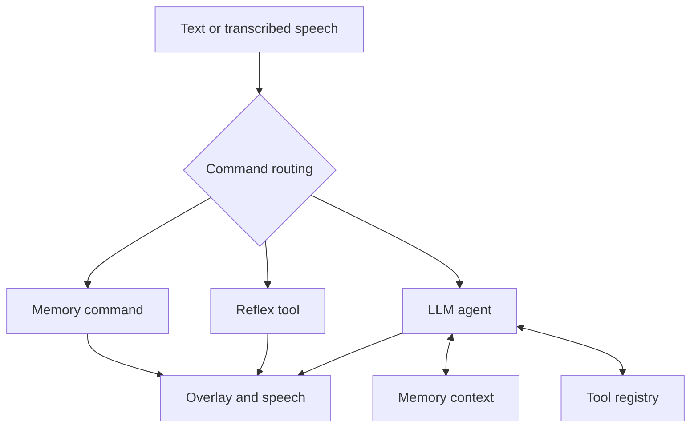

<div align="center">

# JARVIS-MARK5
**A personal assistant built around the Windows desktop.**

Voice and text input, a PyQt6 overlay, tool execution, and persistent memory—an ongoing experiment in practical desktop agents.

[Architecture](#architecture) · [Run locally](#run-locally) · [Record a demo](#record-a-demo)

</div>

---

## Why this project exists

JARVIS-MARK5 explores how a conversational assistant can connect language to useful desktop actions. The goal is to build toward the JARVIS idea one working component at a time: an interface, a command router, tools, speech, and memory.

**Status:** development prototype. The repository contains these components, but a successful end-to-end run must be verified on a configured Windows machine. This README describes the implementation, not a production-readiness claim.

## What's implemented

| Component | Current implementation |
| :--- | :--- |
| Desktop interface | PyQt6 overlay with text submission and state updates |
| Voice input | F9 captures a short audio segment; Groq transcription with local faster-whisper fallback |
| Command routing | Memory commands and regex-based reflex commands run before the LLM path |
| Agent | Groq-backed tool-calling loop with a maximum of eight steps |
| Desktop tools | App launch, time/date, system information, clipboard, file reading, and window titles |
| Memory | SQLite-backed store and background fact/profile maintenance |
| Speech output | Edge TTS synthesis and sounddevice playback |
| Speaker matching | Optional enrollment and similarity checks for voice commands |

## Architecture



The Qt event loop pumps asyncio on a timer. Tool functions run through `asyncio.to_thread`. A shared event bus connects processing state to the overlay.

## Run locally

Use Windows, a Python environment with compatible dependencies, audio output, and a microphone for voice commands. Model-backed requests require a Groq API key.

```powershell
git clone https://github.com/Shivaay170/JARVIS-MARK5.git
cd JARVIS-MARK5
py -m venv .venv
.\.venv\Scripts\python.exe -m pip install -r requirement.txt
```

Create a local `.env` in the repository root:

```dotenv
GROQ_API_KEY=your_key_here
```

Review `config.yaml` for model names and speech settings, then launch:

```powershell
.\.venv\Scripts\python.exe main.py
```

The dependency filename is **`requirement.txt`**, singular. Package versions are currently unpinned. Provider model availability and access depend on your account.

Start with typed input in the overlay:

| Command | Route |
| :--- | :--- |
| `what time is it` | Local reflex tool |
| `system info` | Local reflex tool |
| `open notepad` | Windows app-launch tool |
| `what do you know about me` | Memory command |

These reflex commands avoid an LLM completion, but application startup and speech output can still depend on configuration and network services.

Press **F9** for a voice command. Optional speaker enrollment:

```powershell
.\.venv\Scripts\python.exe main.py enroll
```

Enrollment can download a speaker model and stores the resulting voiceprint locally.

## Implementation notes

- The TTS implementation uses **Edge TTS**, even though `config.yaml` currently labels the voice engine as `onnx`.
- Volume control invokes the external `nircmd` command, which is not installed by `requirement.txt`.
- The shutdown tool currently returns a marker; it is not a demonstrated shutdown implementation.
- Speaker matching is conditional on enrollment. It should not be treated as a strong authentication boundary.
- The configuration's CPU/RAM values are settings, not verified resource limits.
- Local transcription may require downloading a Whisper model. It does not make the entire assistant offline.

## Record a demo

Capture a continuous 25–40 second session on the configured Windows machine:

1. Show the overlay ready for input.
2. Type `what time is it` and show the actual response.
3. Type `open notepad` and keep the launched application visible.
4. If voice input works, press F9 and ask for system information.
5. Keep the response and resulting desktop state in the same recording.

Describe whether input was typed or spoken. Record actual latency; label any edits that remove waiting. Keep API keys, clipboard contents, personal memory, and unrelated windows out of the recording. No demo video is included yet.

## Repository guide

| Path | Responsibility |
| :--- | :--- |
| [main.py](main.py) | Startup, input routing, Qt/asyncio integration |
| [jarvis/brain](jarvis/brain) | Agent loop, LLM client, reflexes, and learning |
| [jarvis/tools](jarvis/tools) | Tool registration and Windows actions |
| [jarvis/senses](jarvis/senses) | Transcription, speech, speaker matching, and vision module |
| [jarvis/memory](jarvis/memory) | Persistent memory and memory tools |
| [jarvis/ui](jarvis/ui) | Desktop overlay |
| [config.yaml](config.yaml) | Model roles, settings, and reflex patterns |

## Next engineering milestones

- Reproducible dependency versions and a documented working Windows setup.
- Measured startup time, response latency, and memory usage.
- End-to-end validation of confirmation flows and failure handling.
- Clear configuration behavior across speech and model providers.

Built by [Shivaay Srivastava](https://github.com/Shivaay170).
